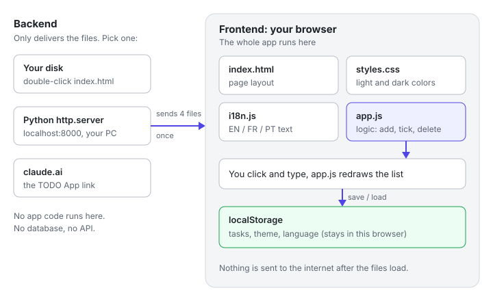

# TODO App

A simple TODO web app built with plain HTML, CSS and JavaScript. There is nothing to install and no build step: clone the repo and open it in a browser, or run
the small built-in server to get user accounts.

## Features

- Add, edit, complete and delete tasks (double-click a task or press its ✎ button to edit; Enter or leaving the field saves, Escape cancels)
- Filter by All, Active or Completed, and clear completed tasks
- Clear all tasks after a confirmation, and undo Clear all or Clear completed from the bar above the footer (see Life of a task for how long)
- Each task shows when it was added: "now", "5 min", the time, the day and month, or the date with the year. Hover it for the full date.
- Follows your system light or dark setting, with a 🌙 / ☀️ button to switch for this site (pressing it again goes back to following the system)
- Language switcher: English, French, Portuguese, Spanish and Polish
- Tasks, theme and language are saved in your browser (localStorage), so they are still there after a reload
- Optional accounts: run `npm start` and each person signs in to their own task list, stored on the server, with email confirmation and password reset

## Project structure

```
index.html   Page layout
styles.css   Styles for the light and dark themes
i18n.js      Translations (English, French, Portuguese, Spanish, Polish)
app.js       App logic
server/      Optional server for accounts (built-in Node modules only)
tests/       Automated tests (npm test), and browser tests in tests/e2e (npm run test:e2e)
docs/        Developer documentation, manual browser checks and architecture diagrams
```

For a detailed description of the code, see the [developer documentation](docs/DEVELOPER.md).

## How it works



Opened as a file or from any static server, the whole app runs in your browser. Whatever opens it (the file on your disk, a local server, or a hosting site)
only delivers the four files, and tasks, theme and language are saved in the browser's localStorage. The diagrams below show this mode.

Run with `npm start` instead, and the page notices the server and switches to account mode: people sign in, and their tasks are kept on the server. See
[Accounts](#accounts).

### App anatomy

**File load order.** `index.html` pulls in the other files in a fixed order. `i18n.js` defines the `TRANSLATIONS` global before `app.js` runs, so swapping those
two script tags would break the app. `app.js` then finds its elements in the page and is the only file that writes saved data. It reads all three keys, and a
small inline script in `index.html` reads `todo-theme` early to avoid a flash of the wrong colors.


**From click to screen and storage.** Every action changes a variable in memory first, then saves it and redraws the screen from that variable. The screen is
never built from `localStorage`, which is read once when the page loads. The filter is the exception to saving: it lives in memory only, so a reload returns to
All.


**Life of a task.** A task is one object. Ticking it changes `done`, and editing changes `text`. Because each change saves `todo-items` before redrawing, a
reload brings every task back as it was. Editing does not change whether a task is Active or Done. Clear completed removes all Done tasks at once; the ✕
button removes a single task from either state. Clear all asks for confirmation first and then removes every task. After Clear all or Clear completed, an Undo
bar puts the tasks back at their original positions; tasks added in between go after them. In local mode the undo is kept in memory only: it stays until your
next action and is lost on reload. In account mode the server keeps the cleared tasks for 15 minutes, and the bar is hidden just before that. Adding, ticking,
editing or deleting a task, signing in or signing out hides the bar.
Each task also records the time it was added (`createdAt`); local tasks saved before this existed get it from their id.


## Run it from a terminal

Clone the repository:

```bash
git clone https://github.com/ArtistaVeKaras/claude-code--todoapp.git
cd claude-code--todoapp
```

**Option 1: open the file directly**

```bash
# macOS
open index.html
# Linux
xdg-open index.html
# Windows (PowerShell or cmd)
start index.html
```

**Option 2: run a small local server** (any one of these works)

```bash
python3 -m http.server 8000
# or, if you have Node.js
npx serve .
```

Then open http://localhost:8000 (or the address `npx serve` prints) in your browser. Press `Ctrl+C` in the terminal to stop the server.

## Accounts

To give each person their own task list, start the built-in server instead. It needs [Node.js](https://nodejs.org) 22.13 or newer and nothing else; there are no
packages to install.

```bash
npm start
```

While you change server code, run `npm run dev` instead. It restarts the server when a server file changes. A server that is already running keeps serving its
old API after you change the code, so restart it or use `npm run dev`.

Open http://localhost:3000, choose **No account yet? Create one**, and sign in. In development, confirmation and password-reset emails are printed in the
terminal; open the link from there.

Tasks are stored in `data/todo.db` (a SQLite file, not committed). For running it on the internet, settings such as `APP_URL` and `NODE_ENV=production`, and how
the security works, see [Accounts and the server](docs/DEVELOPER.md#accounts-and-the-server).

## Tests

```bash
npm test
```

This runs the server, account, undo and translation tests with Node's built-in test runner. It does not load the real page.

Browser tests use Playwright and the Microsoft Edge that is already installed. Install them once, then run them:

```bash
npm --prefix tests/e2e install
npm run test:e2e           # headless
npm run test:e2e:headed    # visible Edge window, one test at a time, slowed down
```

They start their own server on port 3100 with a temporary database, so they never touch the server on port 3000 or `data/todo.db`. The headed run is the final
check. The checks that are still manual are listed in [manual checks](docs/MANUAL-CHECKS.md).

## Run it from Claude Code

Start Claude Code in the project folder:

```bash
cd claude-code--todoapp
claude
```

Then ask it in plain words, for example:

> Start a local server for this app and give me the URL

Claude Code will run `npm start` in the background, and you can open http://localhost:3000 in your browser. You can also just ask it to "open index.html in my
browser" for local mode without accounts.

This repo includes a project skill, [`run-todo-app`](.claude/skills/run-todo-app/SKILL.md), that tells Claude Code exactly how to do this. You can also run it
directly by typing `/run-todo-app`.

## Adding a language

1. Open `i18n.js`, copy the `en` block and translate each value.
2. Add a matching `<option>` to the language select in `index.html`.
